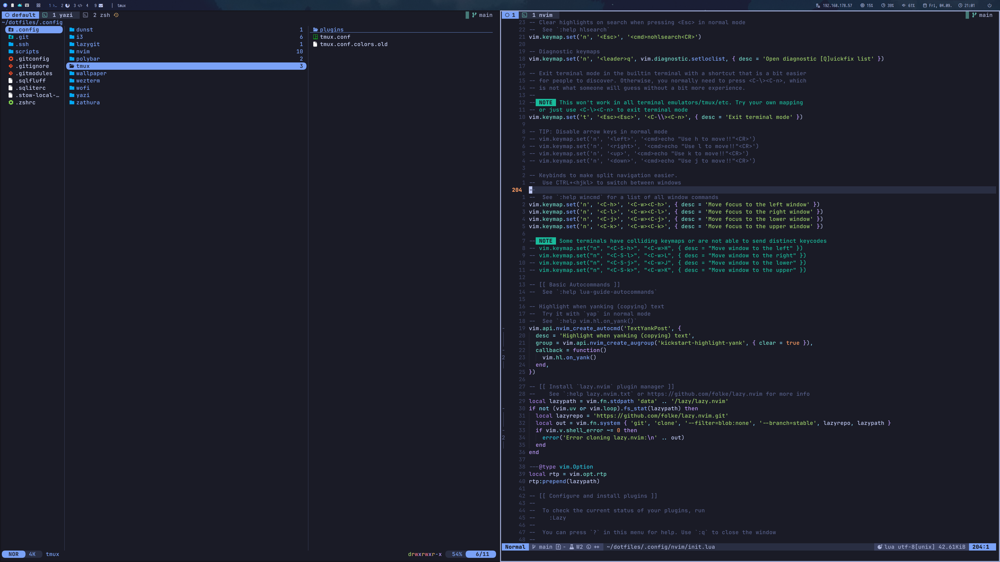

# Dotfiles

Personal configuration for a Linux desktop built around zsh, neovim, and tmux.
Target system: Pop!_OS with the COSMIC desktop (Wayland only).

Using the [Tokyo Night theme](https://tokyonight.org/) for most applications.

The screenshot shows the old i3 setup, which is still in the repo but no longer linked (see [X11 leftovers](#x11-leftovers)).



## Setup on a fresh machine

1. Create an SSH key and add it to GitHub (the clone and the `origin` remote use SSH):

   ```bash
   ssh-keygen -t ed25519
   cat ~/.ssh/id_ed25519.pub
   ```

2. Install git and clone the repo to `~/dotfiles` (the path is expected by some scripts):

   ```bash
   sudo apt install -y git
   git clone git@github.com:tasriel/dotfiles.git ~/dotfiles
   ```

3. Run everything:

   ```bash
   ~/dotfiles/scripts/setup.sh
   ```

   The sudo password is asked once. A failing step does not stop the others;
   a summary at the end lists what worked, and each step logs to `~/.cache/dotfiles-setup/`.

Useful variations:

```bash
~/dotfiles/scripts/setup.sh --list         # show all step names
~/dotfiles/scripts/setup.sh yazi nvim      # run only these steps
```

### What the steps do

| Step | Script | Notes |
|---|---|---|
| base | [`install_base.sh`](./scripts/install_base.sh) | Installs everything in [`packages/apt.txt`](./packages/apt.txt) with one apt call |
| stow | [`stow.bash`](./scripts/stow.bash) | Symlinks the dotfiles into `$HOME` (dry run first, aborts on conflicts) |
| rust | `install_rust.sh` | `rustup` from apt, then `rustup default stable` (the apt `rustc` is too old) |
| yazi | `install_yazi.sh` | Official release `.deb`, installed with apt (not in the Ubuntu repos) |
| nvim | `install_nvim.sh` | Official release tarball, plus tree-sitter-cli via cargo-binstall |
| zsh, fzf, fnm, lazygit, tmux, wezterm, vlc, feh | `install_*.sh` | Individual tools |
| spotify, zulip, element-x, claude | `install_*.sh` | Third-party apt repositories, each trusted only for its own packages |
| thunderbird | `install_thunderbird.sh` | .deb from the Ubuntu Mozilla Team PPA (the package in the Ubuntu archive is only a snap stub), pinned so apt prefers the PPA |
| latex | `install_latex.sh` | latexmk, biber, XeTeX/LuaTeX, German and English language support (about 1 GB); `LATEX_FULL=1 setup.sh latex` installs `texlive-full` instead |
| platformio | `install_platformio.sh` | Also adds the udev rules and the `dialout` group, so log out and in once |
| nerd-font, wallpaper | `setup_*.sh` | JetBrains Mono Nerd Font (per user), dynamic wallpaper |

Everything comes from apt wherever Ubuntu 24.04 (or the vendor's own apt repository) has a recent enough version.
The exceptions are Neovim (apt has 0.9, the config needs 0.12), lazygit (not in Ubuntu 24.04), fzf (apt is too old for `fzf --zsh`),
fnm, Oh My Zsh with its plugins, sunwait, the Nerd Font and tree-sitter-cli (apt version too old).

Shared helpers (apt repositories, GitHub release lookup, PATH handling) live in [`scripts/lib.sh`](./scripts/lib.sh).
All scripts can be run again safely.
To add a package, add a line to `packages/apt.txt`; to add a tool, add a script and list it in `setup.sh`.

### Stow

Using [GNU Stow](https://www.gnu.org/software/stow/) for the symlinks in `$HOME`.
`stow.bash` creates `~/.ssh` and `~/.config/Code` as real directories first, so SSH keys and the VS Code cache never end up inside the repo.
Files that should not be linked are listed in [`.stow-local-ignore`](./.stow-local-ignore).

## Wayland and X11

COSMIC only runs Wayland, so the scripts do not branch between Wayland and X11.
X11-only tools were replaced:

| X11 | Wayland |
|---|---|
| `xclip`, `xsel` | `wl-clipboard` |
| `feh --bg-*` | `swaybg` (feh remains as image viewer via XWayland) |
| `rofi` | `wofi` |

### X11 leftovers

The configs for i3, polybar and dunst stay in the repo but are not linked (see `.stow-local-ignore`).
The old i3 installer was moved to [`scripts/legacy/install_i3.sh`](./scripts/legacy/install_i3.sh) and is not part of `setup.sh`.

## Dynamic Wallpaper

All image credit goes to [Matt Vince](https://www.mattvince.com/).

**Setup via [`./scripts/setup_wallpaper.sh`](./scripts/setup_wallpaper.sh)** (also part of `setup.sh`).

[`scripts/set_wallpaper.sh`](./scripts/set_wallpaper.sh) selects a wallpaper based on the time of day and sunrise/sunset in Berlin.
It needs [swaybg](https://github.com/swaywm/swaybg) (shows the image), [sunwait](https://github.com/risacher/sunwait) (sunrise/sunset), and the wallpaper files under [`.config/wallpaper/`](./.config/wallpaper/).
A cronjob runs the script every hour. The script finds the Wayland socket by itself, so cron needs no session variables.
